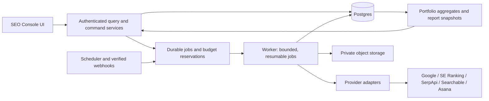

# SEO Console v2 — Product and Implementation Specification

Research date: 2026-10-15. This is a proposed implementation contract, subject to the repository audit and actual provider capabilities.

## 1. Outcome, users, and boundaries

Build an internal SEO operations workspace for 20–30 team members managing 65–80 projects, with 20–300 tracked keywords per project. Connect measurement, investigation, tasks, and reporting around a shared project identity. Preserve working functionality while replacing the navigation and visual system incrementally.

Use `talabadao/seo-console` as the host application. Treat `tin-headsonpillows/ai-brand-mention` as a source of reusable modules. Do not merge unrelated repositories wholesale, replace the host with the donor, or rewrite every feature. Audit the actual deployment branches before deciding what is current.

Observed host snapshot: `main` at `05f0c1dc70cd92193d4d30e80fe315efad50c551`; Next.js 16.3.4, React 19.2.8, TypeScript, Tailwind 4, Recharts, Postgres, iron-session. Observed donor snapshot: `claude/fervent-lovelace-wror83` at `5876464af458f1447eb3049f3c5745d8e32127e6`; Next.js 16.3.5, React 19.2.8, private Blob JSON storage. Re-check these facts in the working checkout. Keep installed compatible versions unless a separately scoped change is necessary. Read existing AGENTS.md, CLAUDE.md and the relevant installed Next.js documentation.

Phase 1 retains the owner's shared company Google login if required. Add the data model for workspace membership and project access immediately. Individual company logins with initially equal permissions are recommended before broad rollout, but do not silently change the authentication requirement. Phase 2 introduces staff/manager assignments and capabilities. Portfolio access is governed by server-side authorization, not by hiding menu items.

## 2. Navigation and routes

Use a persistent application shell with a searchable project selector, `All projects`, collapsible left navigation, breadcrumbs, scope-aware filters, notifications, and profile/settings access. Preserve existing deep links through explicit compatibility routing.

Suggested route root: `/p/[projectId]/...` for project modules and `/portfolio` for the aggregate view. Adapt to the current catch-all route without breaking bookmarks. Do not derive project identity from a mutable display name or domain.

| Navigation | Child views | Phase 1 behavior |
|---|---|---|
| Dashboard | Project overview; All projects | Live aggregates where connected; honest empty/partial states |
| Keyword Research | Explorer, Semantic clusters, SERP clusters, Bulk metrics, Saved keywords | Interactive deterministic demo |
| Competitive Research | Overview, Traffic estimates, Content gap, Sitemap explorer | Interactive deterministic demo |
| Link Building | Backlink analytics, Backlink gap, Prospects | Interactive deterministic demo; no outreach |
| Organic SERP → SE Ranking | Overview, Rankings, Competitors, Backlinks, Site audit, AI prompts | Adapt donor code; live per entitled capability |
| Organic SERP → Google Search Tracking | Overview, Keywords, SERP snapshots, History, Settings | SerpApi; selected tracked contexts |
| Organic SERP → Bing Search Tracking | Same conceptual workflow | Engine-specific SerpApi implementation |
| Organic SERP → Yandex Search Tracking | Same conceptual workflow | Engine-specific SerpApi implementation |
| Organic SERP → Naver Search Tracking | Same conceptual workflow | Engine-specific sections and parameters |
| Google Search Console | Performance, Opportunities, Saved views | Preserve host functionality |
| Google Analytics 4 | Overview, Templates, Explore, Saved dashboards | Live, bounded report builder |
| Local SEO → Google Business Profile | Profile, Competitor comparison, Recommendations | Public listing analysis via SerpApi |
| Local SEO → Google Maps Reviews | Google Maps and Tripadvisor sources, Trends, Aspects, Reviews | Reuse donor review workflow; source-aware UI |
| Technical SEO → Site Audit | Runs, Issues, Pages, Internal links, Cannibalization signals | Bounded crawler and evidence-based checks |
| Technical SEO → PageSpeed Insights | Tracked pages, Lab results, Field results, History | Reuse host; separate PSI and CrUX contracts |
| Technical SEO → Indexing | Inventory, Inspection, Submissions | Reuse host; fix eligibility and quota semantics |
| Content | Briefs, Editorial board, Editor, Review queue | Demo; external actions disabled with explanations |
| AI Area | Google Search Tracking (Overview, Rank tracker, Mentions & Citations, AI responses, Settings); Brand Mentions (Dashboard, Customer reviews, Prompts, AI answers, Platforms & cost estimate) | Port of the AI Brand Mention app onto SEO Console data, auth and metering (owner decision 2026-10-15); Searchable dropped. Usage, costs and budgets live in Settings |
| Automation | Workflows, Schedule, Run history | GBP workflow status/bridge only after audit |
| Report | Weekly Report, Monthly Report | Weekly live; Monthly demo |
| Docs | Product guide, SOPs, Intern training | Real document catalogue; labelled sample content |
| Settings | Project settings (General, Integrations, KPI planning, Analytics / Key events, Tracking, Usage & budgets, Sync and history); Account settings (API credentials, Usage & Costs, Budgets & limits) | Live configuration with scope boundaries (revised 2026-10-16) |

When `All projects` is selected, project-only modules show a project picker rather than selecting a hidden default. Remember safe per-project filters, but never send one project's cached data or credentials into another project. Cancel or ignore stale in-flight responses on scope changes.

## 3. Visual design contract

Use the supplied SEO Utils screenshots for information hierarchy, table density, sidebar grouping, and chart layout. Use the existing Console screenshots for workflows that must survive. Create a distinct SEO Console identity; do not copy another product's marks or unrelated decorative backgrounds.

- Default to English UI to match the current product; keep labels centralized enough for later Vietnamese localization.
- Light neutral canvas, white panels, subtle borders, restrained shadows, dark text, blue primary actions, consistent chart palette. Support the existing theme behavior without making dark-mode polish a blocker for the first shell PR.
- Sidebar width 248–264 px on desktop; compact/icon mode and a drawer on small screens. Keep navigation scrollable with usable Docs/Settings access.
- Content padding 24 px desktop, 16 px small screens; spacing scale 4/8/12/16/24/32. Card radius approximately 10–12 px.
- Body text 14–15 px, tables 13–14 px, page titles 24–28 px, primary KPI values 28–36 px. Preserve a properly licensed current font or use a system stack.
- Standard page layout: breadcrumb/title/actions, filter bar, source/freshness line, KPI cards, charts, detailed table, optional evidence drawer.
- Tables support sorting, search, pagination, column visibility, saved views, CSV, and useful bulk selection. Virtualize only when measured volume warrants it. Stable column widths and right-aligned numeric cells.
- Keyboard-operable controls, visible focus, labelled inputs, non-color status indicators, readable contrast, sensible empty/loading/error states.
- Test at 1440, 1280, 1024, and approximately 390 px. Wide analytical tables may scroll horizontally; the entire page must not overflow.

Reusable primitives: AppShell, ProjectSwitcher, PageHeader, FilterBar, DateRangeComparison, MetricCard, DataTable, ChartPanel, SourceBadge, FreshnessStatus, ConnectionState, BudgetIndicator, EvidenceDrawer, ExportMenu, EmptyState, ErrorState, DemoBanner. Reuse existing component/chart dependencies; add a library only when it resolves an actual requirement.

## 4. Data truth and metrics

Every visible metric has a source, definition, unit, scope, reporting window, and freshness. Missing, not-supported, not-connected, failed, and zero are different values/states. Failed jobs must not overwrite valid snapshots with zeroes. Charts show gaps for missing observations.

Use a shared result envelope, adapted to the codebase:

```ts
type DataMode = 'live' | 'demo' | 'imported';
type DataStatus = 'ready' | 'partial' | 'stale' | 'empty' | 'blocked' | 'error';
interface ResultEnvelope<T> {
  data: T | null;
  mode: DataMode;
  status: DataStatus;
  projectId: string;
  source: string;
  sourceAccountId?: string;
  sourceProjectId?: string;
  window: { start: string; end: string; timezone: string };
  fetchedAt: string | null;
  sourceUpdatedAt: string | null;
  coverage?: { expected?: number; observed?: number; note?: string };
  methodologyVersion?: string;
  warnings: string[];
  reason?: string;
}
```

Secret material and raw provider authentication responses never belong in this envelope.

- GSC CTR = total clicks / total impressions for the same scope; not the average of row CTRs. Query-table totals may differ from provider aggregate totals due to coverage/privacy limits. Preserve the provider's reporting dates and disclose recent incomplete data.
- GA4 report scope must be explicit. Session acquisition and first-user acquisition are different. Compute unique users from the requested reporting window, not by adding daily users. Do not imply deduplicated people across unrelated GA4 properties.
- Preserve source timezone and date-only semantics. Project timezone controls scheduling and business deadlines; it does not rewrite historical source dates. Label timezone differences when comparing providers.
- GSC average position, SE Ranking rank, SERP organic position, and position within an AI answer are separate metrics. Do not merge them into one unlabeled average.
- A ranking observation distinguishes found position, not found within depth N, unsupported, and failed. Record returned depth and all relevant result blocks.
- AI visibility and share of voice must show the denominator, platform, prompt set, country/language, and methodology. Branded and unbranded prompts remain filterable. No invented global “AI score.”
- Review rating, rating-derived sentiment, text sentiment, and AI answer sentiment remain separate. Allow a review sample to open from an aggregate claim.
- Portfolio aggregates use compatible windows/definitions and explicit coverage, e.g. “71/78 projects current.” No averaging percentages without weights, summing duplicates from AgencyAnalytics and direct sources, or treating missing projects as zero.
- Monthly KPI definitions include direction, target, owner, period, source, and version. Targets are not overwritten by later edits to a different month.

## 5. Live module requirements

### Dashboard and work management

Project view: monthly target/actual, trend, upcoming and overdue tasks, tasks completed in the month, source health, priority SEO observations, recent activity. Each observation can link to evidence and an Asana task.

Portfolio view: one row per accessible project, KPI attainment, change, overdue/completed task counts, owner when available, last sync, connection health, and spend. Query materialized aggregates or cached summaries, not 80 provider accounts on page load.

Asana is authoritative for task completion. Cache reads, preserve task GIDs and links, support explicit creation/completion/comment actions with a preview. Handle duplicate submissions, conflicts, webhook retries and reconciliation. Do not mark a task completed in the UI until confirmed or clearly show a pending/failed state. Preserve the existing weekly status-update workflow as a separate action.

Slack is a project inbox from configured channels, not an automatic instruction source. A selected message can produce a task draft with the original permalink. Creating the Asana task is an explicit user action. Do not post Slack messages merely because a task was created unless the workflow is configured to do so.

### GSC and GA4

GSC retains date comparisons, search type, filters, query/page/country/device breakdowns, opportunities, and CSV behavior. Keep existing analytics semantics during the shell migration. Add consistent export and saved views incrementally.

GA4 builder supports curated metric/dimension lists, compatibility checks, date/comparison, channel/source-medium, landing page, device, country, selected key events, sorting, limits, and saved configurations. Templates: SEO overview, Traffic acquisition, Organic landing pages, Key events, AI referrals. Preserve native GA channel values alongside the configurable AI-referral classification; version custom rules and prevent double counting. Explain unavailable combinations and threshold/quality metadata. Do not promise full GA4 Exploration parity.

### SE Ranking

Adapt `src/lib/seranking` and `src/components/seranking` from the donor behind host services. Persist explicit project + engine mapping after a user verifies any suggested match; matching a parent domain is not enough. Maintain six requested tabs. Sync existing data incrementally, paginate, retain per-section failures and last-good values. Core ranking sync, competitor SERP enrichment, backlinks, and AI sections have separate freshness/usage policies. Do not trigger new paid crawls or rank checks just to display a page.

Treat Project API, Data API, AIRT, and SE Visible as capabilities with potentially different entitlements and definitions. Validate payloads; do not treat an unknown successful response shape as an empty successful dataset. Never import the donor's unauthenticated sync assumption or automatic mock fallback.

### Search tracking

Use a tracking context containing keyword, target entity/domain, engine, supported location/country/language/device, depth, and schedule. Phase 1 uses SerpApi keys configured in project Settings or explicitly inherited from workspace Settings. Engine-specific capabilities determine enabled controls and result sections.

Separate “Check now” from “Track on schedule.” Display estimated consumption before execution, deduplicate concurrent identical checks, store the result, and expose job progress. Organic results, advertisements, local packs, AI blocks, related questions, news, and Naver-specific sections are only rendered when returned. Persist raw evidence in private storage with a retention policy; never directly embed untrusted provider HTML.

### Local SEO

Public GBP analysis checks available name/address/phone, categories, site link, opening hours, attributes, rating/review volume and available media. Recommendations cite observed fields and disclose unsupported or missing data. Do not label a heuristic score as an official Google score.

Reuse the donor's Maps/Tripadvisor review ingestion and UI patterns, replacing storage/auth. Deduplicate by source/review ID; keep review dates versus retrieval dates, edits, owner replies, language, business/location and coverage. Imported business identities are explicitly mapped; do not silently share private project state because names match. Classify only new/changed text using versioned rules and controlled spend. Keep original review text available beside translated text.

### Technical SEO

Site Audit begins with bounded HTML crawling on verified/authorized project domains. Crawl sitemap and known URLs, obey robots rules, limit depth/pages/concurrency/response size/redirects, and stop at budget/time limits with a continuation cursor. Block private, loopback and link-local destinations including redirect/DNS changes. Exclude infinite URL parameters and duplicate normalized URLs. Declare that JavaScript-rendered content may need a later rendering mode.

Checks: status codes, redirect chains/loops, canonical, robots directives, title/meta/H1 presence and duplication, sitemap issues, robots.txt, internal link graph, broken links, and candidate cannibalization from GSC query–page data. Rules have severity, evidence, affected URLs, first/last seen, status, and configurable thresholds. llms.txt is informational; word/character counts are heuristics. No automated SEO edits in this phase.

PSI keeps mobile/desktop and lab/field separate; prioritize representative URLs and show field-data absence/origin fallback. Inspection queues follow per-property quotas and checkpoint progress. Do not treat a successful IndexNow notification or Google API submission as confirmed indexing. General Google pages use inspection and supported discovery workflows; the specialized Indexing API must be eligibility-gated.

### AI Area

_Revised 2026-10-16 (owner decision 2026-10-15): Searchable is out of scope. Phase 1 ports the AI Brand Mention app's two screens._

- **Google Search Tracking**: SerpApi Google results (organic ranks to the chosen depth, AI Overview, AI Mode) for a project's keywords; Overview, Rank tracker, Mentions & Citations, AI responses, Settings. Organic SERP → Google opens the same data on the Rank tracker view, so there is one set of runs and charges.
- **Brand Mentions**: answers from Google AI Mode and AI Overview (SerpApi) and, when enabled, ChatGPT and Claude (web search), analysed for brand mentions, sentiment, claims and sources; Dashboard, Customer reviews (the project's own Google Maps reviews), Prompts, AI answers, Costs & limits.
- **Usage & Costs**: provider-reported figures (SerpApi account, OpenAI and Anthropic cost reports, DataForSEO balance when configured) next to the app's own ledger; estimated costs carry the pricing version.
- **Rules**: every route checks sign-in and project ownership; data lives in Postgres per project (no donor history imported); no placeholder answers — unavailable sources say why; runs start only on request (no schedules in phase 1), show the estimate first, and are metered and capped (see Budget below). Tripadvisor and Google Hotels aren't connected.

The earlier Searchable plan is kept below for reference.

Searchable would have been the source of record for AI visibility, with explicit project mapping and verified scopes. Reuse donor layouts and reusable analysis components, not its automatic direct-model runs as a substitute. Import documented available metrics, prompt details, citations, competitors, sentiment and responses, with pagination/history bounds recorded.

Use absent/unsupported states for fields unavailable in the account. Preserve metric meaning and time scope; do not infer mention counts from a percentage. Keep source-provided metrics separate from local recomputations. Phase 2 DataForSEO adapters remain a documented interface until specifically selected for implementation.

## 6. Demo and deferred workflows

Demo data is deterministic, realistic, internally consistent, and isolated from live persistence. Use one fictional project across research, content, and monthly reporting so drill-downs make sense. Filters, sort, details, demo saves and CSV work. Display Demo on pages, screenshots and exports. Live integrations that lack credentials show connection instructions instead of demo data.

- Keyword Research: keyword, volume, CPC/currency, difficulty with source definition, intent, trend, group, selected keywords and saved list. Clusters expose membership and demo rationale.
- Competitive Research: domain comparison, top pages/queries, estimated traffic, content gap and suggested tasks, all labelled demo.
- Link Building: referring domains, links, anchors, new/lost, gap and prospects; no outreach or paid enrichment.
- Content: project brief/brand voice/audience/approved claims, keyword/outline, rich editor, title/meta/headings/link checklist, version history and editorial board. Statuses: Brief → Draft → Internal review → Client review → Changes requested → Approved → Scheduled → Published. External statuses are simulated in demo. Show Google Doc and WordPress action previews without executing them.
- Future content integration: create a Docs review copy with version mapping, import explicit feedback into a proposed revision, require a human to accept changes, create a WordPress draft, then publish only a specifically approved revision. Client approval must be recorded; it cannot be inferred from silence or an arbitrary comment. Preserve external document/post IDs, prevent duplicate posts, detect concurrent changes, and respect CMS SEO-field/plugin support.
- Monthly Report: executive summary, KPI, GSC/GA4, ranking, AI visibility, technical/local changes, completed tasks and next month plan. Preserve source attribution; no auto-send. AgencyAnalytics adapter remains gated until account/schema validation.
- Automation: show the supplied GBP Post Auto Sheet as a linked workflow. Audit actual columns, Apps Script/triggers, executor, credentials, idempotency, approval state and write-back behavior before connecting a run action. SerpApi is not a GBP publishing API.
- Docs: searchable catalogue, categories, owners and update dates. Link existing Drive/Docs/Sheets with current access permissions. Label authored examples as samples rather than company-approved SOPs.

## 7. Architecture and persistence

Keep a modular Next.js application with a durable background execution path. Do not introduce microservices for every module. UI reads server-owned query services/caches; providers execute on the server; cron enqueues work instead of doing an entire agency sync in one request.



Minimum foundations: workspaces, memberships, projects, project access/mappings, connections, connection capabilities, sync jobs/attempts, usage/reservations, audit events. Add module-specific tables only when implementing the module: keyword contexts/observations, reviews/analyses, audit runs/issues, saved views, tasks/external links, report snapshots, and content revisions/approvals.

Every project-owned row has workspace/project scope; external identifiers include provider and connection scope. Enforce uniqueness at the database layer for idempotency. Keep provider business dates separate from UTC ingestion timestamps. Composite indexes follow real queries by project/source/date. Store large response bodies/images in private object storage with authorized access; store queryable metadata in Postgres. Avoid object-storage read-modify-write as the concurrency mechanism for task status or budgets.

Settings (revised 2026-10-16, implemented in #13–#17):

- **Account settings** belong to the signed-in account (internal user id), with or without a project open.
  - *API credentials*: SerpApi, OpenAI API, Anthropic API and DataForSEO (API login + API password), shared by all of the account's projects; other accounts keep their own. Stored with AES-256-GCM under CREDENTIALS_ENCRYPTION_KEY (not the session secret), bound to account and provider, with a key id per row for rotation. Storage status (Saved: masked hint, last updated) is separate from connection status (Verified / Check failed / Untested), which comes only from non-billable checks. Saving never runs anything billable. Asana and Bing account connections are listed here too.
  - *One credential resolver* for every consumer: legacy project key (until resolved) → account credential → a server key only for accounts listed in LEGACY_SERVER_CREDENTIAL_ACCOUNTS. Identical legacy project keys are consolidated into the account credential; different ones are never chosen between automatically.
  - *Usage & Costs*: one report, account-wide with a project filter and per-project attribution; provider-reported balances, app-recorded consumption and estimated cost kept apart.
  - *Budgets & limits*: account-wide SerpApi requests/month and model spend/day; per-project SerpApi requests/month and model spend/month. Unset values use the server defaults. Every applicable limit is enforced together on each request (atomic take with refund), including Maps reviews.
- **Project settings → KPI planning**: monthly targets per project, metric and period (YYYY-MM) in a spreadsheet-style grid for any range of months (presets: next 6 / 12 months, calendar years). Paste from Excel / Google Sheets, copy a month, fill, compound growth, with a preview before replacing values; blank (no target) and 0 are distinct; Save all is one transaction with conflict detection. The dashboard, All projects and the Weekly report read these targets; the current month follows the project's GA4 time zone.

Credentials: server-only encrypted storage with key versioning and redaction; safe rotation; scope selection; test-connection action; show only masked metadata. OAuth connection ownership is separate from the person using the app. Preserve reauthorization/revocation behavior. Company email allowlisting is validated server-side from verified identity. All mutations and cron/webhook endpoints require the appropriate authorization and CSRF/signature/replay defenses.

Provider adapters expose capabilities, credential verification, quota/usage when available, and module-specific reads/commands. No invented endpoint names. Record source docs/version and sanitized contract examples. Distinguish 401/403, quota/rate-limit, timeout, schema mismatch and no-data responses.

Jobs: persistent queued/running/succeeded/partial/failed/cancelled/paused-budget states; lease/heartbeat, bounded attempts, exponential backoff with jitter, Retry-After, checkpoint cursor, per-connection distributed concurrency/rate limits and fair project scheduling. Dedupe scheduled/manual duplicates by operation context/window. A worker crash must be recoverable without silently repeating costly writes. External writes whose result is ambiguous require reconciliation before retry.

Budget: reserve estimated maximum cost atomically against workspace/project/provider/credential limits, record actual usage and settle/release appropriately. Unknown price/usage is visible as unknown, not zero. Keep currency and provider credit units separate. Do not rotate keys to evade a provider/account quota. Store pricing assumptions with date/version and refresh them from verified sources before budgeting live runs.

## 8. Migration and rollback

1. Inventory both repositories, runtime configuration names, active features and deployment SHAs. Never print secret values.
2. Baseline existing screenshots, deep links and critical flows with sanitized fixtures; record existing lint/type/build failures separately.
3. Add the new shell behind a feature flag. Existing data endpoints remain compatible during initial wrapping.
4. Backfill workspace/project identity using an explicit map: host project ID ↔ donor project ID ↔ external resource IDs. Ambiguous domain/name matches require review; never pick silently.
5. Import donor Blob records using a dry-run manifest with counts, checksums, source paths, unmapped records and deterministic IDs. Use rerunnable batches. Validate sample metrics and history before enabling new reads. Keep the donor unchanged and avoid duplicating scheduled jobs.
6. Use additive migrations and an expand/backfill/validate/contract sequence. Rehearse backup restoration. Removing old columns/routes is a later release after successful rollback windows.
7. Route one module at a time to its new implementation. Preserve old route compatibility and last-good snapshots.
8. Pilot 3–5 projects, then expand through approximately 10, 30 and 80 with observability. Rollback routes/flags and compatible schema without losing data written by the new app.

## 9. Acceptance gates

- All requested routes exist and accurately show Live, Demo, Not connected, Unsupported, Partial or Error states.
- Existing GSC, GA4, Weekly Report, Indexing, PSI and review workflows remain available; data comparisons are correct for matched scopes.
- Switching projects during slow requests cannot leak data from the previous project. Direct API access enforces the same boundary.
- All six SE Ranking tabs handle entitlement failures independently and never fabricate missing production data.
- Four SERP engines have capability-aware inputs; a failed observation never becomes rank zero or a success record.
- Fake providers exercise 429/5xx, partial pages, timeouts and unknown schemas. No real paid requests are used by CI.
- Two simultaneous sync requests do not schedule duplicate work or bypass budget limits. A killed worker resumes from its checkpoint. Duplicate webhooks do not create duplicate tasks.
- No browser request/bundle, exported screenshot, CSV, trace or error contains a secret.
- Copy image and Download PNG work at card/section level; clipboard failure has a download fallback. Export contains project, period, filters and source; Demo is watermarked. CSV exports neutralize spreadsheet-formula injection.
- Load tests use simulated 80 projects, up to 24,000 keyword contexts before optional combinations, and 30 active sessions. Measure list/query latency, database connections and queue throughput; report hardware, fixtures and results rather than claiming unmeasured performance.
- Operational targets to validate: cached dashboard p95 around 2 seconds on the agreed test environment; responsive project switching; 95%+ scheduled core sync completion within each configured daily window during pilot. These are proposed targets, not measured guarantees.
- Preview uses isolated database/storage, scoped test credentials, schedules off and external writes off by default. Production rollout requires the owner's release decision after a reviewable PR and validation evidence.
